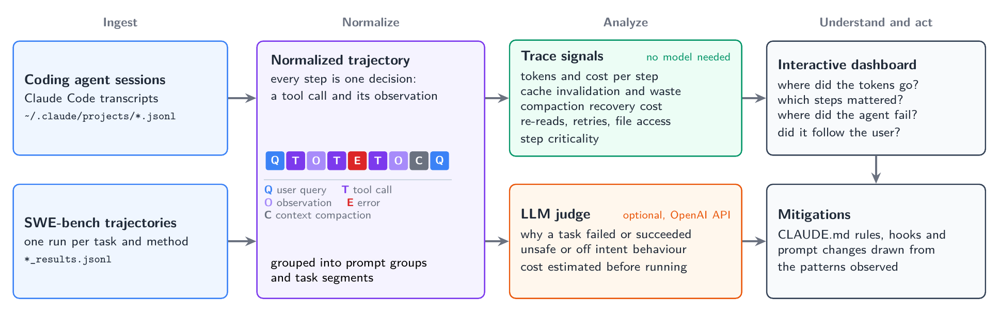

# Crossroads: Visual Analytics for Agent Sessions

Crossroads is a visual analytics system for understanding what an LLM agent did during a session: where the tokens went, which steps were productive, where the agent wasted effort, which failures happened, and whether the agent followed user intent.



*Figure: Crossroads ingests coding agent sessions and SWE-bench trajectories, normalizes each one into a sequence of steps (user queries, tool calls, observations, errors and context compactions), computes trace signals that need no model, optionally runs an LLM judge, and presents the results as an interactive dashboard together with suggested mitigations.*

## Why Crossroads

Real agent sessions rarely look like a benchmark run that ends with passing tests. In one session a user may ask several questions, interrupt the agent, and see it succeed on one task and fail on another. Tokens are also expensive, so engineers want to know whether they were well spent and where most of them went. And as agents are given more autonomy, passing tests is not enough: it matters whether the agent followed the user's intent and avoided destructive actions along the way. Crossroads is built to answer these questions from the session transcript alone.

## Overview

Each session is normalized into a flat list of steps. A step is one agent decision: a tool call together with its observation. Crossroads then provides:

- **Overview and corpus views** across all sessions: cost, duration, failure risk, models and projects
- **Token economics**: where the input and output tokens went, cache dynamics and cache invalidation waste
- **Compaction lens**: what changed around context compaction and how much it cost to recover
- **Segments and time series**: task switches within a session and cost, tokens and waste over wall clock time
- **Failures**: free failure signals (tool errors, retries, failed tests), plus optional LLM judge analysis
- **Anomaly audit**: optional LLM judge detection of unusual or unsafe behaviour
- **File heatmap and query map**: which files were read, edited and tested, and how user queries cluster by topic
- **Actions**: recommendations for CLAUDE.md rules, hooks and pre-prompts drawn from the observed patterns
- **SWE-bench views**: spine, conversation and failure analysis for SWE-bench trajectories

Trace based metrics (cost, cache, re-reads) need no model. Only the views marked as judge analysis call an LLM, and they stay off until you set an API key.

## Installation

```bash
pip install -r requirements.txt
```

## Quick Start

Run the server from the repository root:

```bash
python backend/run.py --port 8000
```

Then open http://127.0.0.1:8000. The API is available under `/api/`, for example `/api/health` and `/api/trajectories`.

Without any configuration Crossroads reads sessions from `~/.claude/projects`. Point it elsewhere with the environment variables below.

Running the tests (from the repository root):

```bash
python -m pytest tests/
```

## Configuration

All settings are environment variables, read in [`backend/crossroads/settings.py`](backend/crossroads/settings.py).

| Variable | Default | Description |
|----------|---------|-------------|
| `CROSSROADS_SESSIONS_DIR` | `~/.claude/projects` | Root folder of agent session transcripts |
| `CROSSROADS_SWE_DIR` | `data/swe` | Folder of SWE-bench style trajectories |
| `CROSSROADS_CACHE_DIR` | `~/.cache/crossroads` | Where cached judge results are stored |
| `OPENAI_API_KEY` | none | API key for the judge endpoint. Only needed for judge analysis |
| `OPENAI_BASE_URL` | unset (OpenAI) | Base URL of another hosted provider with an OpenAI compatible API |
| `CROSSROADS_JUDGE_MODEL` | `gpt-4o-mini` | Model name sent to the judge endpoint |

Crossroads calls the judge through the standard `openai` Python package. With an OpenAI key, only the key is needed:

```bash
export OPENAI_API_KEY=sk-...
python backend/run.py
```

To use another hosted provider with an OpenAI compatible API, also set its base URL and a model it serves:

```bash
export OPENAI_API_KEY=your-provider-key
export OPENAI_BASE_URL=https://your-provider.example/v1
export CROSSROADS_JUDGE_MODEL=provider-model-name
python backend/run.py
```

Judge results are cached in SQLite, so re-running a judge on the same session does not call the model again.

## SWE-bench Trajectories

The SWE views read every `*_results.jsonl` file in `CROSSROADS_SWE_DIR`. Each line is one task run:

```json
{"task_id": "owner__repo.commit.bug_id", "condition": "my_agent", "resolved": true,
 "num_steps": 17, "total_tokens": 99363, "cost_usd": 0.33, "duration_s": 93.5,
 "trajectory": [{"step": 0, "thought": "Run the tests first", "tool": "bash",
                 "args": {"command": "pytest"}, "raw_observation": "..."}]}
```

`condition` (or `method`) names the agent configuration, so several configurations of the same task can be compared side by side. Each trajectory step has a `tool`, its `args`, the agent's `thought`, and the observation it received (`served_observation` if the observation was compressed, otherwise `raw_observation`). Optional fields such as `input_tokens`, `output_tokens` and a per step `tier` fill in the token and tier views.

```bash
export CROSSROADS_SWE_DIR=/path/to/swe_results
python backend/run.py
```

## Repository Structure

```
.
├── backend/
│   ├── run.py                  # Serves the API and the built frontend on one origin
│   └── crossroads/
│       ├── app.py              # FastAPI routes
│       ├── parse_claude.py     # Claude Code transcript parser
│       ├── swe_parser.py       # SWE-bench trajectory parser
│       ├── models.py           # Normalized trajectory, step and outcome models
│       ├── metrics.py          # Cost, cache and re-read metrics
│       ├── economics.py        # Token budget, cache invalidation and waste
│       ├── compaction*.py      # Compaction lens and diff
│       ├── failure_analysis.py # Failure signals and LLM judge analysis
│       ├── anomaly_audit.py    # LLM judge anomaly audit
│       ├── swe_failure_analysis.py
│       ├── judge.py            # Judge cost estimate
│       ├── judge_cache.py      # SQLite cache for judge results
│       ├── settings.py         # Environment configuration and the judge client
│       └── ...                 # Scoring, segments, timeseries, topics, overview
├── frontend/
│   ├── dist/                   # Built web interface (served by run.py)
│   └── package.json
├── figures/                    # Overview figure (PNG and its TikZ source)
├── tests/                      # API smoke tests
├── requirements.txt
├── LICENSE                     # MIT
└── README.md
```

## Limitations

- The web interface ships as a built bundle in `frontend/dist`. Its TypeScript source is not included in this repository, so the interface can be used but not edited from here.
- Scores from the judge are model outputs and should be checked against the underlying trace before they are trusted.
- Cost figures use the pricing tables in `metrics.py` and should be updated when provider prices change.

## Citation

```bibtex
@software{crossroads2026,
  title={Crossroads: Visual Analytics for Agent Sessions},
  author={Paul Trust},
  year={2026},
  url={https://github.com/paultrust26/crossroads}
}
```

## Author

Paul Trust ([trustpaul1000@gmail.com](mailto:trustpaul1000@gmail.com))

## License

MIT. See [LICENSE](LICENSE).
